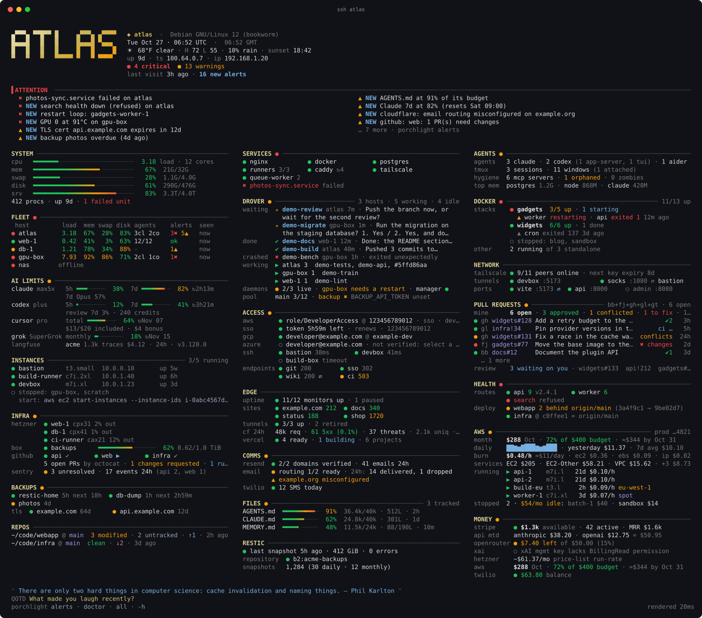
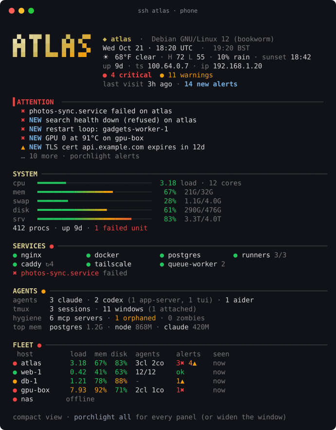
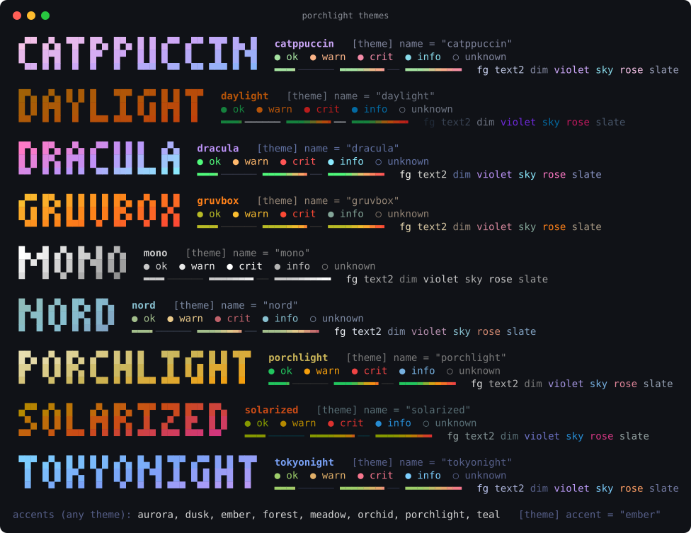

<h1 align="center">porchlight</h1>

<p align="center"><b>A fast, fleet-aware login dashboard for your terminal.</b><br>
Vitals, services, AI agents and their plan limits, containers, pull requests, cloud status,
backups, certificates and costs, ranked into one attention list, rendered from cache in milliseconds.</p>

<p align="center">
<a href="https://github.com/coletebou/porchlight/actions/workflows/ci.yml"></a>


<a href="LICENSE"></a>
</p>

<p align="center"></p>

---

You log in, and before your prompt appears you already know that the disk on
`db-1` is at 88%, a container on `web-1` is crash-looping, your Claude plan's
weekly window is at 92%, a certificate expires in 12 days, last night's backup
did not run, and two of your pull requests have conflicts. That's porchlight.

- **Instant.** A login never touches the network. A background collector refreshes
  every source on its own schedule; the dashboard reads JSON plus a few cheap local
  probes and renders in ~10-40 ms, even over SSH from a phone.
- **One attention strip.** Everything that needs you, from every source and every
  machine, ranked, deduplicated, and tagged **NEW** since your last login.
- **Fleet-aware with nothing new to run.** Make one machine the hub: it pushes
  account-wide data to the others and pulls their status in one SSH round trip each,
  over your existing `~/.ssh/config`. No agent, no open port, no server.
- **Identities.** Keep work and personal credentials apart: a source runs, and its
  secrets load, only on machines whose identity it serves.
- **Batteries included, bring your own.** 30+ built-in sources; any command
  (JSON, plain lines, or any Nagios plugin) becomes a source and a panel; Python
  plugins for the rest.
- **Looks right everywhere.** Truecolor gradients with 256/16-color fallbacks,
  `NO_COLOR`, an ASCII mode that turns on by itself when the locale cannot
  show glyphs, 1-3 column masonry from phone to ultrawide, nine themes.
- **Zero dependencies.** Python 3.9+ standard library, macOS and Linux (WSL too).
- **Safe by design.** Read-only probes. AI login tokens are never refreshed or written. Secrets
  never reach the cache, a log, argv or an error message.

## Quick start

```sh
pipx install git+https://github.com/coletebou/porchlight   # or: pip install --user git+https://…
porchlight demo          # a sample fleet, no setup needed
porchlight init          # write a config from what this machine actually has
porchlight collect       # fill the caches now (afterwards a timer does it)
porchlight install all   # refresh every 5 minutes + show the dashboard at login
```

No pipx? Run it from a checkout, no install step at all:

```sh
git clone https://github.com/coletebou/porchlight ~/.local/share/porchlight
~/.local/share/porchlight/bin/porchlight demo
```

## What it shows

| Panel | What's in it |
|---|---|
| **header** | your hostname in big gradient letters (built-in pixel fonts, figlet, your own art, or a logo via chafa), OS, local + second clock, weather, uptime, Tailscale and LAN IPs, alert counts, "last visit 3h ago · 2 new alerts" |
| **ATTENTION** | every warning and critical, ranked, two columns when wide, **NEW** badges |
| **SYSTEM** | CPU load, memory, swap and each disk as heat-gradient meters; procs, uptime, failed units; hung network mounts reported, never waited on |
| **SERVICES** | systemd units (system and user, globs, merged groups like `runners 3/3`, restart counts), failed units, launchd jobs and Homebrew services, processes you watch |
| **AGENTS** | Claude Code, Codex, Aider, Gemini, OpenCode, Goose, Cursor Agent, Amp, Copilot… running counts, orphaned agent and MCP processes, zombies, tmux, top memory |
| **AI LIMITS** | Claude, Codex, Cursor and Grok plan windows (5 h / 7 d / per model) with reset times and credits, read-only |
| **DOCKER** | compose stacks up/total, unhealthy, restarting, recent crashes (not clean exits or deliberate stops), expected containers missing |
| **PULL REQUESTS** | yours and those awaiting your review on GitHub, GitLab, Gitea, Forgejo and Bitbucket Cloud: conflicts, approvals, changes requested, CI where available |
| **FLEET** | every machine's load, memory, disk, agents and alerts, offline detection that ignores Tailscale's flapping bit |
| **NETWORK** | Tailscale peers and key expiry, live ssh tunnels (`-L`/`-R`/`-D`), your dev ports (⇄ when served through a tunnel) |
| **ACCESS** | AWS identity and SSO token clock, opt-in GCP and Azure account checks, VPN/VPC reachability, internal endpoints (direct or via SOCKS) |
| **INSTANCES** | your EC2 instances, with start hints for stopped ones |
| **HEALTH** | your own health routes (two-strike flap guard), MongoDB, deploy drift (deployed SHA vs `origin/main`) |
| **EDGE** | public sites with latency, UptimeRobot, Cloudflare tunnels, traffic and 5xx rate, Vercel deploys |
| **INFRA** | Hetzner servers and storage boxes, GitHub CI per repo, Sentry, AWS account |
| **COMMS** | Resend domains and bounces, Cloudflare email routing, Twilio |
| **BACKUPS** | systemd backup jobs judged by the service's result, not its timer; files that must stay fresh; TLS expiry |
| **FILES** | size budgets for files that break when they grow (`CLAUDE.md`, `AGENTS.md`, memory indexes) |
| **MONEY** | Stripe balance and MRR, API spend month to date (Anthropic, OpenAI, OpenRouter, xAI), run-rates |
| **REPOS** | branch, dirty, ahead/behind, untracked, last commit |
| **footer** | a quote, a question of the day, and how long the render took |

Panels without data stay hidden. On a phone-width terminal you get the compact view:

<p align="center"></p>

## How it works

```
login ─► porchlight --login ─► reads ~/.cache/porchlight (+ cheap local probes) ─► ~20 ms
                │  stale? starts one background collector (at most one per 30 s)
timer ─► porchlight collect ─► every due source, in parallel, each with its own TTL,
                               timeout and failure isolation; one JSON record each
hub ──ssh──► peers: push the account-wide records, pull each peer's snapshot
```

A failing source keeps its last good data and shows it as stale ("✖ 3h"), so a
panel never goes blank. An expired login is a soft failure, not an outage. A
deploy that restarts a service is not an alert until it fails twice. More in
[docs/architecture.md](docs/architecture.md).

## Configure

`porchlight init` writes a commented starter file. A taste of
`~/.config/porchlight/config.toml`:

```toml
repos = ["~/code/shop"]
ports = [{ port = 5173, label = "vite" }]

[general]
secrets_files = ["~/.config/porchlight/secrets.env"]   # read by the collector only

[theme]
name = "porchlight"          # nord dracula gruvbox catppuccin tokyonight solarized daylight mono
accent = "ember"

[services]
systemd = ["nginx", "postgresql", { unit = "actions.runner.*", label = "runners" }]

[sources.weather]
latitude = 52.52
longitude = 13.40
units = "metric"

[sources.sites]
targets = [{ label = "shop", url = "https://shop.example.com" }]

[sources.certs]
targets = ["shop.example.com"]

[sources.github]
repos = ["acme/shop"]

[hosts."prod-*"]             # per-machine overrides by hostname glob
general.role = "server"
theme.accent = "ember"
```

Everything is in [docs/configuration.md](docs/configuration.md). `porchlight doctor`
flags unknown settings, with "did you mean…?" suggestions.

## Sources

| | |
|---|---|
| **This machine** | process census and AI agents · Tailscale · repos · health routes · TLS certificates · backups · file budgets · deploy drift · MongoDB · weather (Open-Meteo, NWS, wttr.in) · quotes |
| **AI plans** | Claude (Pro/Max) · Codex (ChatGPT plans) · Cursor · Grok |
| **Cloud and SaaS** | Cloudflare · Vercel · UptimeRobot · Hetzner · GitHub CI · Sentry · Stripe · Resend · Langfuse · Anthropic, OpenAI, OpenRouter and xAI spend · AWS account · Twilio |
| **Developer machines** | Docker/Podman compose stacks · AWS, GCP and Azure credentials · EC2 instances · GitHub, GitLab, Gitea, Forgejo and Bitbucket Cloud pull requests · VPN and endpoint reachability |
| **Yours** | `[[custom]]` commands (JSON, lines, Nagios plugins) · Python plugins |

Reference: [host sources](docs/reference/core.md) · [AI plans](docs/reference/ai.md) ·
[cloud and SaaS](docs/reference/saas.md) · [developer machines](docs/reference/dev.md) ·
[custom commands and plugins](docs/plugins.md).

`porchlight sources` lists every source and whether it runs on this machine
(and if not, why: `needs targets`, `opt-in`, `no docker`, `not allowed`…).

## Bring your own checks

```toml
[[custom]]
name = "restic"
title = "BACKUP"
command = "~/bin/check-restic --json"     # {"status": "warn", "summary": "...", "rows": [...]}
ttl = 3600

[[custom]]
name = "disk-home"
command = ["/usr/lib/nagios/plugins/check_disk", "-w", "15%", "-c", "8%", "-p", "/home"]
```

Or a Python plugin in `~/.config/porchlight/plugins/`:

```python
from porchlight import source, panel, kv

@source("todo", ttl=300)
def todo(ctx):
    n = sum(1 for line in open("/home/me/todo.txt") if line.strip())
    return {"open": n, "alerts": [{"sev": "warn", "msg": "%d open todos" % n}] if n > 20 else []}

@panel("todo", title="TODO")
def todo_panel(x):
    d = x.data("todo")
    return x.panel("todo", [kv("open", str(d["open"]))]) if d else None
```

See [docs/plugins.md](docs/plugins.md).

## A fleet

```toml
[fleet]
peers = ["web-1", "db-1", "nas"]    # ssh aliases; this machine becomes the hub
```

Every few minutes the hub pushes its account-wide records (cloud status, AI
limits, weather) to each peer and pulls the peer's vitals and alerts, in one
SSH call per peer. Peers render every panel without holding a single API key;
the hub's FLEET panel shows everyone. If the hub goes quiet, a peer that has
the credentials takes over that source until it is back.
[docs/fleet.md](docs/fleet.md).

## Keep work and personal apart

```toml
[general]
identity = "work"

[identities.work]
allow = ["procs", "docker", "aws_auth", "prs", "reach", "claude_usage"]   # nothing else ever runs here
secrets_files = ["~/.config/porchlight/work.env"]
```

## Commands

```
porchlight                 the dashboard        porchlight doctor       why is X stale or missing
porchlight all             every panel          porchlight sources      what runs here, and why not
porchlight docker prs      just those panels    porchlight json [src]   raw cached records
porchlight alerts          ranked, with fixes   porchlight top          where the CPU and memory went
porchlight collect         refresh now          porchlight themes       preview every theme
porchlight init            starter config       porchlight label        this machine's display name
porchlight install all     timer + login hook   porchlight demo         a sample fleet
```

Flags: `--width N`, `--theme NAME`, `--color truecolor|256|16|none`, `--ascii`,
`--compact`, `--full`. The login hook (`porchlight install shell`) runs it once
per session, not in every tmux pane, with a 5-second safety timeout.

## Themes

<p align="center"></p>

`porchlight themes` previews them on your terminal; `PORCHLIGHT_THEME=nord
porchlight` tries one. [docs/themes.md](docs/themes.md).

## Security

Read-only probes, credentials only in request headers or a child's environment,
no redirects with credentials, errors scrubbed twice, a cache of summaries
(mode 0600), and AI logins that are never refreshed or written.
[docs/security.md](docs/security.md).

## FAQ

**Does it slow down my shell?** No: it reads a cache. The footer shows the render
time (typically 10-40 ms); `PORCHLIGHT_DISABLE=1` skips it for one session.

**What if I'm offline / off VPN / Docker isn't running?** Those are states, shown
dimmed, not alerts. Alerts are for things you can act on.

**Does it phone home?** No telemetry, ever. The only network calls are the
sources you configure (weather and quotes are on by default; set
`[sources.weather] enabled = false` and `[sources.quotes] enabled = false`).

**Windows?** WSL, yes (including the Windows drive and the Windows Tailscale
client). Native Windows shells, no.

**Can I use it as the system MOTD for all users?** It is a per-user dashboard:
each user's cache and credentials are their own. Install it per user.

## Development

Coming from fleet-motd? See the [migration guide](docs/migrating-from-fleet-motd.md)
for configuration and provider mappings.

```sh
python3 -m unittest discover -s tests   # no network, ~1 s
bin/porchlight demo --width 120
scripts/screenshots.sh                   # regenerate docs/img
```

[CONTRIBUTING.md](CONTRIBUTING.md) · [CHANGELOG.md](CHANGELOG.md) · [MIT license](LICENSE)
